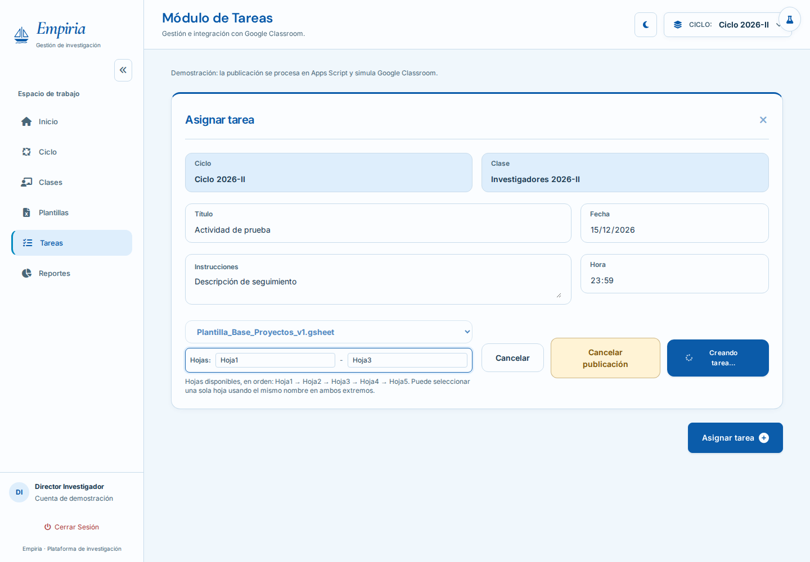
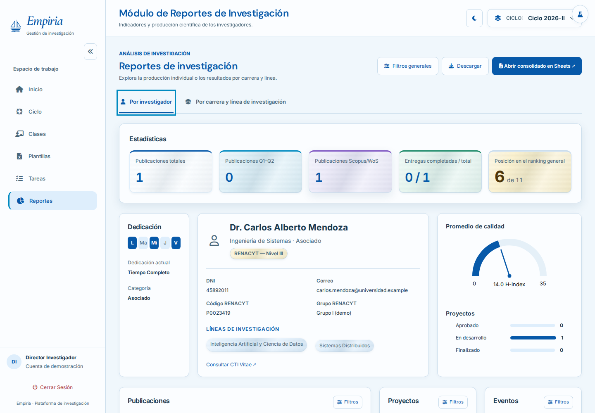

# Alpine.js en los dos casos de uso

## Qué se implementó

| Criterio | CU-002: Generar Actividad de Seguimiento | CU-005: Generar reporte de seguimiento de investigación |
| --- | --- | --- |
| Navegación | Menú y accesos controlados por `$store.navegacion` | Módulo y pestañas individual/carrera controlados por el mismo store |
| Carga de servidor | `cargandoPlantillas`, `publicando`, `cancelando` | `cargando`, `abriendoConsolidado` |
| Poblamiento | `obtenerPlantillasTarea` → array `plantillas` → opciones con `x-for` | `obtenerDatosReportes` → `datos` → selectores y filas de publicaciones con `x-for` |
| Entrada y filtros | `x-model` en título, descripción, fecha, hora, plantilla y rango de hojas | `x-model` en selectores de ambos reportes y búsquedas de publicaciones |
| Fin de petición | `try/catch/finally` o manejador de la transacción restaura controles | `finally` restaura controles, con mensaje y reintento ante error |

La publicación sigue siendo una **simulación de Classroom**, ejecutada ahora en el servidor de Apps Script. No se llama a la API real de Classroom. El acceso de demostración no es autenticación.

## Dónde leer el código

1. `src/vistas/Index.html`: carga Alpine 3.17.5 con `defer`, define `x-data` y compone las vistas.
2. `src/vistas/Navegacion.html`: registra `Alpine.store('navegacion')`; `vistaActual` determina qué módulo se muestra con `x-show`.
3. `src/scripts/Reactivos.html`: contiene `llamarServidor`, el adaptador compartido que convierte los callbacks de `google.script.run` en promesas. `AlpineTareas.html` registra el store `tareas` y el formulario inicial; `AlpineReportes.html` registra el store `reportes`. Cada archivo escucha `alpine:init` y se incluye antes del inicio diferido de Alpine. Las directivas siguen en las vistas.
4. `src/vistas/Tareas.html`: enlaza los campos con el estado, recorre las plantillas y presenta carga/error.
5. `src/vistas/FlujosTareas.html`: procesa respuestas, reintenta cuotas, registra auditoría y coordina cancelación con el servidor.
6. `src/vistas/ReporteInvestigador.html` y `ReporteCarrera.html`: selectores, búsquedas y filtros.
7. `src/vistas/TablaPublicaciones.html`: tabla compartida, con un `x-for` para columnas y otro para filas.
8. `src/servidor/Código.gs`: endpoints de datos, publicación simulada y cancelación.

## Recorrido de CU-002

Al entrar, `cargarPlantillas()` activa `cargandoPlantillas` y llama a `obtenerPlantillasTarea(ciclo)`. La respuesta se valida y sus objetos alimentan `disponibles`. El HTML recorre ese array con `x-for`; cada opción tiene una clave `plantilla.id`. Si falla, el mensaje queda visible y Reintentar vuelve a consultar.

`x-model` mantiene el formulario en `$store.tareas.formulario`. Al enviar, `crearTarea` valida los datos y crea un `idOperacion`. `publicando` pasa a `true`: el texto cambia a «Creando tarea…», se deshabilitan campos y envío, y aparece Cancelar publicación. `procesarPublicacion` espera `publicarActividadDemo`. Una respuesta válida confirma la transacción y muestra el ID devuelto por el servidor; un fallo restaura los controles y conserva los datos introducidos.

El servidor valida de nuevo título, descripción, ciclo, fecha en hora de Lima, plantilla y rango de hojas. No basta validar en el navegador: los parámetros pueden manipularse antes de enviar.

### Reintento y cancelación

- Una cuota excedida permite tres reintentos con espera progresiva. El formulario permanece bloqueado hasta el resultado final.
- Un reintento de la misma petición conserva `idOperacion`. El registro simulado devuelve la respuesta anterior en vez de crear otra tarea.
- `cancelarActividadDemo` registra `Cancelado` aunque llegue antes que la publicación, o revierte el registro si llega después. Las dos operaciones usan el mismo bloqueo de usuario.
- Una respuesta tardía se descarta si la transacción ya no está En Proceso. Si la cancelación está esperando respuesta, el éxito queda pendiente hasta conocer el resultado de cancelar.
- Si la cancelación falla, se informa y puede reintentarse; no se afirma que la operación fue cancelada.
- El registro usa caché por usuario ejecutor y sesión de demostración, con un máximo de 100 operaciones y caducidad de hasta seis horas. Google puede desalojarlo antes. No es almacenamiento permanente, autenticación ni garantía de idempotencia de producción.

## Recorrido de CU-005

`$store.reportes.cargar()` activa `cargando`, oculta paneles y llama a `obtenerDatosReportes`. En `catch` presenta el error y habilita Reintentar; en `finally` termina la carga. La respuesta válida se conserva en `datos`.

Las opciones de cada selector están en `opciones[id]`, su selección en `filtros[id]` y su estado vacío en `sinOpciones[id]`. `llenarSelectReporte()` actualiza esos arrays y valores; Alpine actualiza las opciones con `x-for`. `valorReporte()` lee el estado reactivo, por lo que los cálculos no dependen de esperar que el navegador repinte los selectores.

Las funciones existentes calculan indicadores, gráficos y registros filtrados. Para publicaciones, `renderizarColeccionInv()` actualiza `tablas[tipo]` con filas, columnas, total y página. `TablaPublicaciones` recorre las filas con `x-for` y claves estables para la página. La misma vista sirve para `publicaciones` y `carrera-publicaciones`. Búsqueda, filtros de columna, orden y paginación actualizan esos datos y Alpine vuelve a pintar la tabla.

`x-html` se limita al formateador existente `celdaColeccionInv`, que escapa los textos y valida protocolos de enlaces. Los nombres y etiquetas usan `x-text`. No se inserta HTML sin procesar recibido del servidor.

Los gráficos, perfiles, diálogos de detalle y listados de proyectos/eventos conservan sus renderizadores existentes, separados de los nodos migrados. No se escribe `innerHTML` sobre los selectores o las tablas principales de publicaciones controlados por Alpine.

## Directivas para explicar individualmente

| Directiva/API | Para qué se utiliza |
| --- | --- |
| `x-data` | Habilitar Alpine en el body y definir el tipo de tabla en la sección de publicaciones |
| `Alpine.store` / `$store` | Compartir estado entre archivos HTML incluidos por Apps Script |
| `x-show` | Mostrar vistas, carga, mensajes y acciones según el estado; mantiene formularios y filtros al navegar |
| `x-cloak` | Evitar que los módulos se vean antes de inicializar Alpine |
| `x-model` | Sincronizar el valor de los controles y el estado |
| `x-for` / `:key` | Crear opciones, columnas y filas desde arrays; identificar los elementos al actualizar |
| `x-text` | Presentar texto sin interpretarlo como HTML |
| `:disabled`, `:class`, `:aria-busy` | Actualizar propiedades, apariencia y accesibilidad |
| `@click`, `@change`, `@submit.prevent` | Atender acciones y evitar el envío tradicional del formulario |
| `Alpine.nextTick` | Esperar la actualización de la vista antes de ejecutar acciones que dependen del DOM |

Preguntas útiles para ensayar: ¿dónde comienza y termina la carga?, ¿qué ocurre si falla el servidor?, ¿por qué se valida dos veces?, ¿qué distingue una promesa de una respuesta inmediata?, ¿por qué no usar `innerHTML` sobre un `x-for`?, ¿qué ocurre si una respuesta llega después de cancelar?, ¿qué parte sigue siendo una simulación?

## Verificación y despliegue posterior

- `npm ci` instala las herramientas de pruebas; no compila la aplicación.
- `npm test` comprueba servidor, validaciones, idempotencia, cancelación y sintaxis/composición.
- `npx playwright install chromium` prepara el navegador de pruebas.
- `npm run test:browser` ejecuta el cliente real con Alpine y los endpoints del servidor bajo dobles de los servicios de Google.
- Si ya existe un Chromium compatible, puede usarse `EMPIRIA_CHROMIUM_PATH=/ruta/al/ejecutable npm run test:browser`.
- Las capturas se guardan fuera del repositorio, en el directorio temporal del sistema; `EMPIRIA_CAPTURAS` permite elegir otro destino.

Por decisión del usuario, **no se desplegó en Apps Script**. Cuando se retome, habrá que copiar también los nuevos HTML `Reactivos` y `TablaPublicaciones`, además de `Navegacion` y los archivos existentes, conservando los nombres planos. La integración con Google, permisos y configuración de ejecución se comprobará entonces.

La demo mantiene los ciclos de referencia y el activo 2026-II. Para otro periodo hay que actualizar el catálogo de ciclos y las validaciones de fecha del servidor. Las plantillas nuevas del módulo CU-003 siguen siendo demostraciones locales: publicar acepta el catálogo validado del servidor. La integración de CU-003 con almacenamiento no forma parte de esta actualización.

## Evidencia de la verificación local

El 2026-11-05 pasaron **6 pruebas de servidor y 16 escenarios de navegador**, sin errores de JavaScript/Alpine ni IDs duplicados después de actualizar las vistas. Se generó además un PDF real mediante Chromium, a partir del HTML de exportación.

Las capturas muestran los datos de demostración:

